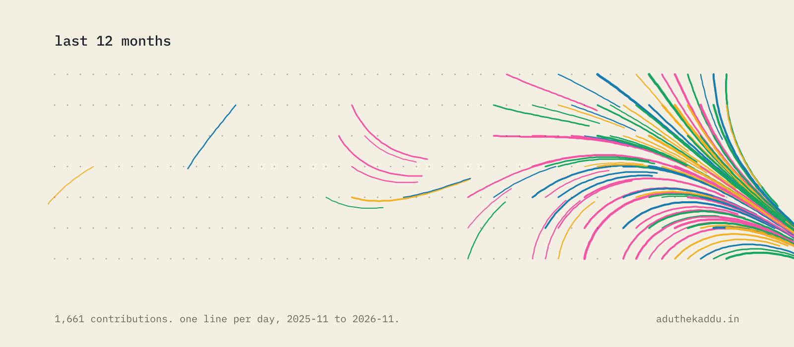

<picture>
  <source media="(prefers-color-scheme: dark)" srcset="assets/editor-dark.svg">
  
</picture>

**romper** &nbsp;a remote desktop in the browser, for you and your agents 
**orbit** &nbsp;a self-hosted chat app for one person 
**between moves** &nbsp;a private chess house for a small group who already know each other

<picture>
  <source media="(prefers-color-scheme: dark)" srcset="assets/year-dark.svg">
  
</picture>

Aditya Singh &nbsp;·&nbsp; Noida, India &nbsp;·&nbsp; Adobe Experience Manager by day, coding agents by night &nbsp;·&nbsp; <a href="https://aduthekaddu.in">aduthekaddu.in</a>
